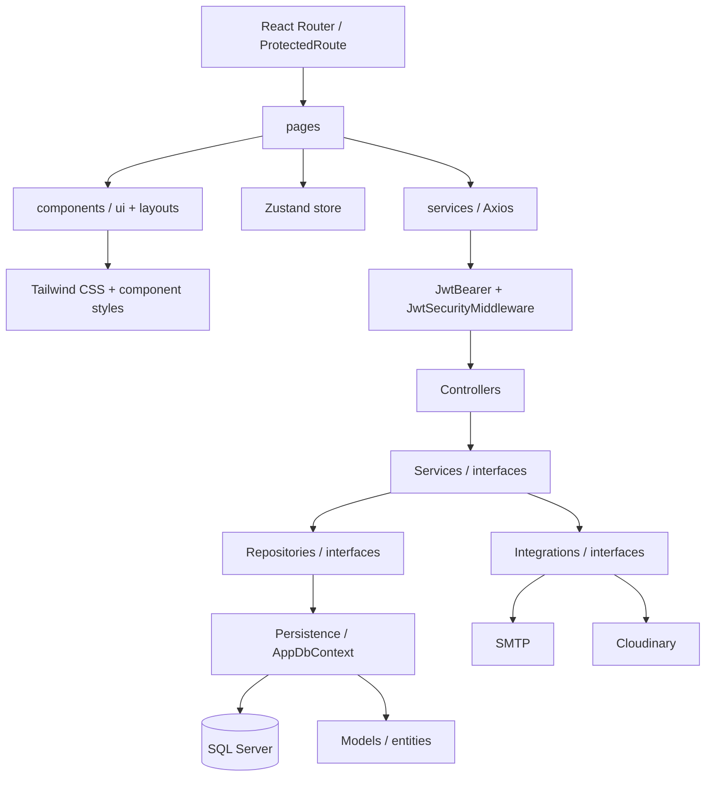

# VNC HRMS — kiến trúc và quy ước làm việc

Hệ thống dùng **một React SPA** và **một ASP.NET Core 8 Web API**, chia module nghiệp vụ Auth, Users, Employees, Organization. Đây là ứng dụng phân lớp (modular monolith), không còn triển khai các microservice hay microfrontend riêng.



## Frontend

```text
frontend/
  src/
    pages/            # Màn hình tương ứng URL; PascalCase + Page.tsx
      auth/           # Login, Register, ForgotPassword, ResetPassword, ChangePassword
      accounts/       # List, Create, Detail, Edit
      employees/
      departments/
    components/       # Component hiển thị và form theo nghiệp vụ
      ui/             # Alert, Modal, PasswordInput, DataTable, Icon
    layouts/          # AuthLayout và AppLayout
    routes/           # AppRoutes, ProtectedRoute
    services/         # axiosClient, authApi, accountApi, employeeApi, departmentApi, fileApi
    store/            # useAuthStore, useAppStore, useRecoveryStore
    hooks/            # useAccounts, useOtpRecovery
    types/            # Kiểu dữ liệu TypeScript
    utils/            # Kiểm tra mật khẩu, định dạng ngày/tên
    styles/           # Tailwind entry và stylesheet component
```

- `App.tsx` khởi tạo phiên đăng nhập; `AppRoutes.tsx` định nghĩa URL. Không thêm màn hình bằng biến `screen` trong một App.tsx lớn.
- `ProtectedRoute` kiểm tra đăng nhập/vai trò ở giao diện. Backend vẫn luôn kiểm tra quyền độc lập.
- `services/axiosClient.ts` quản lý base URL, cookie, JWT, chuẩn hóa lỗi và phối hợp một lần refresh khi nhiều request cùng gặp 401. API công khai dùng Axios instance riêng để không gửi Bearer token cũ.
- Zustand lưu phiên vào `sessionStorage`. OTP chỉ lưu challenge ID, email, hạn dùng và thời gian chờ gửi lại; không lưu mã OTP hoặc mật khẩu.
- `components` nhận dữ liệu/callback qua props. Truy vấn và điều phối nằm ở page hoặc hook. Chỉ đưa trạng thái dùng chung vào Zustand; trạng thái form nằm trong component.
- Tailwind được tích hợp qua plugin Vite. CSS component hiện có được giữ để bảo toàn giao diện; component mới có thể dùng utility classes trực tiếp.

| URL | Chức năng | Quyền |
| --- | --- | --- |
| `/login`, `/register` | Đăng nhập, đăng ký theo hồ sơ nhân viên | Công khai |
| `/forgot-password`, `/reset-password` | Gửi OTP và đặt lại mật khẩu | Công khai |
| `/` | Trang chủ của người đang đăng nhập | Đã đăng nhập |
| `/change-password` | Đổi mật khẩu | Đã đăng nhập |
| `/accounts`, `/accounts/new` | Danh sách, tạo tài khoản | Admin |
| `/accounts/:id`, `/accounts/:id/edit` | Chi tiết, sửa tài khoản | Admin |
| `/employees`, `/departments` | Hồ sơ nhân viên, khoa/phòng | Admin |

## Backend

```text
backend/
  Program.cs              # Composition root: đăng ký DI và middleware pipeline
  Controllers/            # HTTP, model binding, validation, response, cookie
  Services/
    Interfaces/           # IAuthService, IUserService, IEmployeeService, ...
  Repositories/
    Interfaces/           # IUserRepository, IAuthRepository, IUnitOfWork, ...
  DTOs/                   # Request, response theo module
  Models/                 # Auth, Users, Employees, Organization
  Persistence/
    AppDbContext.cs        # DbContext runtime dùng chung cho một request
    TimestampDbContext.cs
    Migrations/           # Bốn chuỗi migration tương thích database cũ
  Configurations/         # DI, JWT, Swagger, Options/Settings, mapping entity
  Middlewares/            # GlobalExceptionMiddleware, JwtSecurityMiddleware
  Integrations/
    Interfaces/           # IEmailService, ICloudinaryService
  Common/                 # AppException, PasswordHelper
```

Luồng xử lý là **Controller → IService → IRepository → EF Core → SQL Server**. Controller không truy vấn DbContext, Service không viết LINQ/SQL hay phụ thuộc kiểu kết quả HTTP, Repository không quyết định quyền nghiệp vụ. Adapter bên ngoài được gọi qua interface trong Service. Các module giao tiếp bằng lời gọi C# trong cùng ứng dụng, không có InternalApi hay khóa HTTP nội bộ.

`JwtBearer` kiểm tra chữ ký, issuer, audience và hạn token. `JwtSecurityMiddleware` đọc session hiện hành để áp dụng việc khóa tài khoản, đổi vai trò hoặc thu hồi phiên ngay. `GlobalExceptionMiddleware` trả JSON lỗi với `message` và `traceId`; CORS dùng middleware chuẩn của ASP.NET Core và danh sách origin cụ thể.

`IUnitOfWork` dùng chung AppDbContext cho transaction. Tạo tài khoản và credential được lưu cùng transaction. Cập nhật tài khoản kiểm tra rowversion, giữ ít nhất một admin đang hoạt động và chặn tự hạ quyền/tự khóa. Refresh token được băm, xoay vòng và đặt trong HttpOnly cookie.

Quên mật khẩu chỉ gửi tới email của **tài khoản đang hoạt động**. SMTP sender không phải người nhận cố định. Mã OTP mặc định 6 số, hết hạn sau 5 phút, tối đa 5 lần thử. Gửi lại thay challenge và vô hiệu mã trước. Giao diện chờ 30 giây giữa các lần gửi; backend giới hạn 5 yêu cầu/15 phút/IP. Địa chỉ không tồn tại và tài khoản bị khóa vẫn nhận thông báo chung để tránh dò tài khoản.

## SQL Server và migration

Giữ database `VNC_HRMS_Iteration1` và các schema `auth`, `users`, `employees`, `organization`. Không drop database, không tạo lại bảng chỉ vì chuyển kiến trúc. Các migration ID và bảng `__EFMigrationsHistory` theo schema được giữ.

`AppDbContext` là context duy nhất được inject vào Repository lúc chạy. Bốn context trong `Persistence/Migrations` chỉ phục vụ EF tooling và giữ lịch sử đã phát hành; chúng dùng cùng cấu hình entity với AppDbContext, không phải bốn dịch vụ chạy riêng.

Để thêm một thay đổi schema, cập nhật entity và mapping trong `Configurations/Entities`, sau đó tạo migration trên context sở hữu bảng. Ví dụ, chạy tại `backend`:

```powershell
dotnet ef migrations add AddUserField --context UserDbContext --output-dir Persistence/Migrations/Users
powershell -ExecutionPolicy Bypass -File scripts/Update-Database.ps1
```

Các context tương ứng là `AuthDbContext`, `UserDbContext`, `EmployeeDbContext`, `OrganizationDbContext`. Không tạo một migration khởi tạo AppDbContext trên database đã có các bảng này.

## SMTP, Cloudinary và môi trường triển khai

- User Secrets ID vẫn là `vnc-hrms-auth-development`, nên máy đã cấu hình Gmail/JWT trước khi refactor không phải nhập lại. Chỉ một project Backend đọc bộ cấu hình này.
- `Configure-Email.ps1` lưu SMTP qua stdin vào User Secrets; mặc định **không đổi email admin**. Không commit `.local`, mật khẩu SMTP, signing key hay Cloudinary API secret.
- Cloudinary adapter gọi Signed Upload API bằng HTTPS; `/api/files` chỉ cho admin, giới hạn 10 MB và kiểm tra chữ ký tệp JPG/PNG/PDF. Tệp dùng authenticated delivery. URL upload trả về là định danh tài nguyên được bảo vệ; màn hình tải tài liệu sau này cần thêm signed download theo quyền hồ sơ. Upload không tự liên kết một tài liệu với nhân viên.
- Để bật Cloudinary, cấu hình `Cloudinary:CloudName`, `Cloudinary:ApiKey`, `Cloudinary:ApiSecret` riêng. Khi chưa cấu hình, upload trả 503 rõ ràng. Chưa có thông tin Cloudinary trong môi trường hiện tại để xác minh upload thật.
- Development: Vite proxy `/api` đến `http://localhost:5100`. Production: cấu hình reverse proxy đưa `/api` đến Web API và fallback URL frontend về `index.html`; hoặc đặt `VITE_API_BASE_URL` trước khi build và cấu hình CORS/HTTPS phù hợp.
- Nếu nhiều thành viên chạy localhost riêng, mỗi máy thiết lập DB/JWT/SMTP riêng. Nếu dùng chung backend đã triển khai, chỉ máy server cần thông tin gửi email.

## Thêm một module mới

1. Định nghĩa DTO và entity/mapping cần dùng; tạo migration theo schema tương ứng nếu thay đổi SQL.
2. Thêm `I...Repository` và implementation chứa truy vấn EF Core.
3. Thêm `I...Service` và implementation chứa nghiệp vụ; đăng ký trong `DependencyInjection`.
4. Thêm `...Controller : ControllerBase` với route và policy thích hợp.
5. Frontend thêm `...Api.ts`, page và component, sau đó đăng ký URL trong `AppRoutes.tsx` và menu trong `AppLayout.tsx`.
6. Chạy `dotnet build` trong backend và `npm run build` trong frontend trước khi gửi thay đổi cho nhóm.
