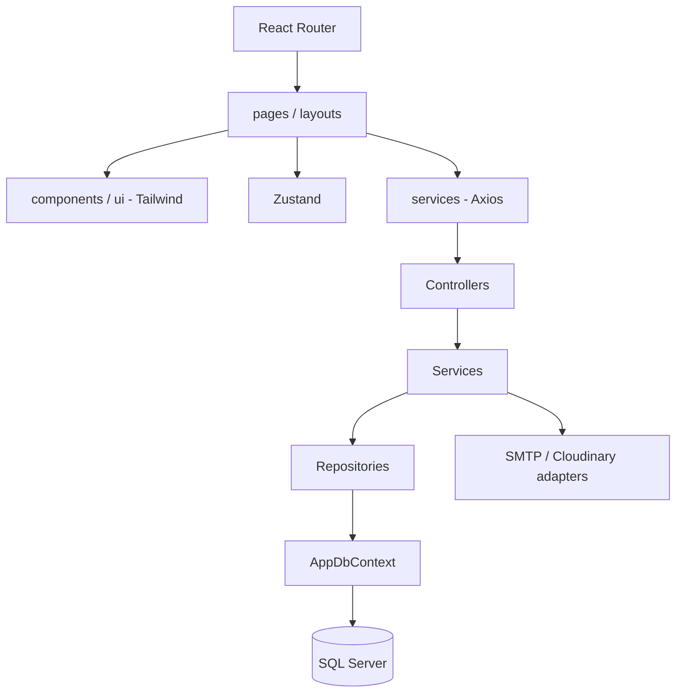

# Kiến trúc VNC HRMS

Một React SPA và một ASP.NET Core 8 Web API phân lớp, chia module trong cùng ứng dụng, dùng một database VNC_HRMS_Iteration1.

## Backend

- Controllers: route/HTTP và validation; tên ...Controller.cs, kế thừa ControllerBase.
- Services/Interfaces: hợp đồng I...Service; implementation ...Service.cs xử lý nghiệp vụ và transaction.
- Repositories/Interfaces: hợp đồng I...Repository; implementation truy vấn EF Core, không truy vấn SQL trong controller.
- Models: entity danh từ số ít PascalCase; DTOs: ...Request/...Response/...Dto.
- Persistence: AppDbContext, factory, migrations và timestamp; Configurations: DI, JWT, Swagger, options và mapping EF.
- Common/Middlewares/Security: exception, helper, lỗi toàn cục và 6 role policies.
- Integrations: adapter SMTP và Cloudinary dùng chung, chưa có endpoint upload/email.

JWT signature/issuer/audience/expiry và role policy đã được cấu hình. Kiểm tra phiên SQL và cấp/refresh/revoke token thuộc nghiệp vụ xác thực; các module được bảo vệ cần tuân thủ hợp đồng phiên chung. Không xem JWT policy trong base là toàn bộ luồng xác thực đã hoàn thiện.

## Frontend

pages, components/ui, layouts, services (Axios), store (Zustand), routes, hooks/types/utils/styles. Mỗi màn kết thúc bằng Page.tsx, HTTP module ...Api.ts, store use...Store.ts. Base chỉ đăng ký trang Home và 404; guard/store/client được chuẩn bị để thêm chức năng.

## Database

Một context quản lý toàn bộ các schema iam, hr, attendance, payroll, compliance, notification trong cùng database. InitialApplication là migration nền cho các module. Giữ nguyên ID và password hash khi import; các bảng không đồng nghĩa các API/nghiệp vụ đã hoàn thành.

## Quy trình nhóm

1. Thống nhất DTO/route/policy với thành viên liên quan.
2. Thêm repository, service và controller cho module; đăng ký DI.
3. Khi đổi entity/mapping, tạo migration mới; không sửa migration đã dùng chung.
4. Thêm API client, page, route/menu frontend đúng quyền.
5. Build và kiểm tra chức năng trước khi commit.

Không thêm project API/port/database riêng cho từng nghiệp vụ. Không commit secret, .local, node_modules, bin, obj hoặc dist.
