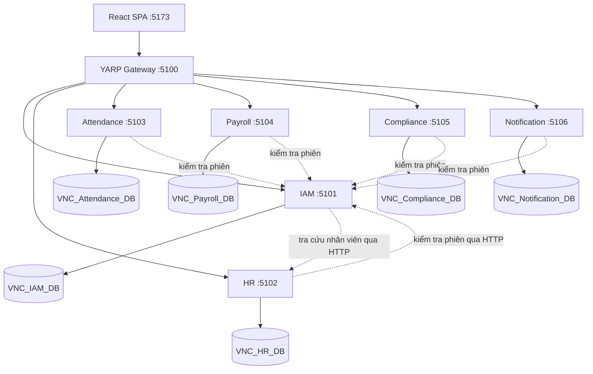

# VNC HRMS — kiến trúc microservices

Một React SPA gọi YARP Gateway. Sáu API sở hữu database riêng trên cùng SQL Server instance lúc phát triển. Service không tham chiếu project của service khác và không query database của nhau.

## Ranh giới

| Service | Quyền sở hữu |
| --- | --- |
| IAM | Users, credentials, refresh tokens, OTP, audit logs và system policies |
| HR | Staff, departments, positions, contracts, degrees; adapter upload Cloudinary |
| Attendance | Import, attendance records, ca trực, nghỉ phép, lịch mẫu, bảng công tháng |
| Payroll | Phiếu lương, phụ cấp, thuế, bảo hiểm, hoa hồng/phiếu thủ thuật, thai sản, xuất ngân hàng, khiếu nại |
| Compliance | Chứng chỉ, chu kỳ/hoạt động CME, kết quả quét |
| Notification | Thông báo và trạng thái đã đọc; recipient luôn là IAM user ID |

Mỗi service giữ schema nghiệp vụ (`iam`, `hr`, `attendance`, ...) bên trong database riêng. FK chỉ nằm trong database sở hữu. Ví dụ Payroll lưu `staff_id`, không tạo FK hoặc JOIN đến HR. FK nội bộ bị thiếu ở bản SQL được bổ sung trong mapping EF.

## Tổ chức code

Các chức năng hiện có giữ luồng **Controller → Service/interface → Repository/interface → DbContext**. Các API đọc mới dùng Service và Repository nhỏ theo domain; thêm interface khi có nhiều implementation hoặc cần thay adapter. Controller không truy vấn SQL trực tiếp.

`BuildingBlocks` chứa xử lý lỗi, JWT, session validation, timestamp, HTTP client nội bộ và DTO hợp đồng trao đổi. Entity nghiệp vụ, repository và DbContext thuộc từng service. Không tạo DbContext dùng chung cho sáu database. IAM và HR có UnitOfWork riêng; một transaction chỉ bao trùm database của service đó.

Frontend giữ React Router, pages/components, Zustand và Axios. Base URL `/api` không đổi; Vite proxy đến Gateway ở cổng 5100. Endpoint IAM (`/api/auth`, `/api/users`) và HR (`/api/employees`, `/api/departments`, `/api/files`) giữ hợp đồng hiện có.

## Xác thực và giao tiếp

Mỗi API tự xác minh JWT (issuer, audience, chữ ký và hạn). Với endpoint được bảo vệ, middleware tiếp tục kiểm tra phiên hiện hành: IAM đọc database của mình; các service còn lại gọi `/internal/sessions/{id}` ở IAM. Điều này giữ việc khóa tài khoản, thay quyền và logout có hiệu lực ngay. IAM không gọi HR trong bước kiểm tra phiên, nên không có vòng gọi khi xác thực.

IAM gọi API nội bộ HR để xác minh hồ sơ khi đăng ký/tạo tài khoản. Lookup đăng ký dùng POST để email không xuất hiện trong URL. Khóa `X-Internal-Key` bảo vệ `/internal`; Gateway chỉ route danh sách prefix `/api` công khai. Lỗi/timeout dịch vụ liên quan trả 503 và không bỏ qua xác thực. Chưa retry các thao tác ghi để tránh ghi lặp.

JWT không thay thế phân quyền: IAM quản lý tài khoản chỉ dành Administrator; phần quản lý nhân viên/khoa phòng của HR chỉ dành HR Manager. Administrator dùng danh sách nhân viên tối thiểu qua IAM để cấp tài khoản, không được mở toàn bộ hồ sơ HR. Xem [phạm vi UC-01, UC-02, UC-07](PERMISSIONS.md). API đọc Attendance/Payroll/Compliance và Notification được giữ nguyên trong đợt phân quyền này; các UC của thành viên khác không được triển khai thêm.

Refresh token băm, xoay vòng, giữ trong HttpOnly cookie ở `/api/auth`. OTP vẫn có giới hạn số lần thử, hết hạn và vô hiệu sau khi sử dụng. Rate limiting chạy trong IAM; chỉ tin forwarded headers từ loopback hoặc Gateway được cấu hình trong KnownProxies. Compose cố định Gateway ở `172.30.70.10` trên mạng `172.30.70.0/24` để giữ đúng IP nguồn; nếu đổi subnet cần đổi cả địa chỉ Gateway và KnownProxies.

## Khác biệt có chủ ý so với SQL tham chiếu

- Giữ bảng `iam.credentials` riêng thay vì nhét mật khẩu vào `iam.users`, đồng thời giữ OTP, security version và rowversion để bảo toàn các cơ chế bảo mật hiện có.
- Giữ email/normalized username/employee ID trên tài khoản. `iam.users.employee_id` là liên kết chính dùng cho đăng ký và unique chống cấp nhiều tài khoản cho một nhân viên. `hr.staff.user_id` cho phép NULL để tạo nhân viên trước tài khoản; chưa dùng cột này để quyết định nhân viên đã có tài khoản.
- Các unique index trên cột nullable dùng filtered index, cho phép nhiều nhân viên chưa có email, số giấy tờ hoặc mã thiết bị.
- Giữ `pay_month` dạng `nvarchar(7)` để tương thích bản SQL, bổ sung CHECK cho kỳ công/lương chính. Các trạng thái chưa chốt bộ giá trị chưa được áp CHECK tùy đoán.
- Bổ sung CHECK cho khoảng ngày, tỷ lệ và một số giá trị không âm; chuẩn hóa timestamp mặc định về UTC. Context cập nhật `updated_at` khi SaveChanges.
- `approved_by`, `recipient_id` và các cột tác nhân dùng IAM user ID; `staff_id` và các trường nhân sự nghiệp vụ dùng HR staff ID.

## Phạm vi tiếp theo

Chưa có message broker, Outbox, Saga hoặc job phát thông báo. Chưa triển khai import/chốt công, tính/chốt lương, snapshot/phiên bản tính lương hay quét CME tự động. Khi thêm những luồng này, xác định hợp đồng API/sự kiện và idempotency; không dùng giao dịch xuyên database trong nghiệp vụ runtime. Giữ phiếu lương đã chốt cùng dữ liệu đầu vào và phiên bản công thức bất biến.

`Legacy/` là bản lưu của monolith và migration đã phát hành, ngoài solution và Docker build. Chỉ script chuyển dữ liệu offline được đọc đồng thời database cũ và các database mới. Xem [MIGRATION.md](MIGRATION.md).
