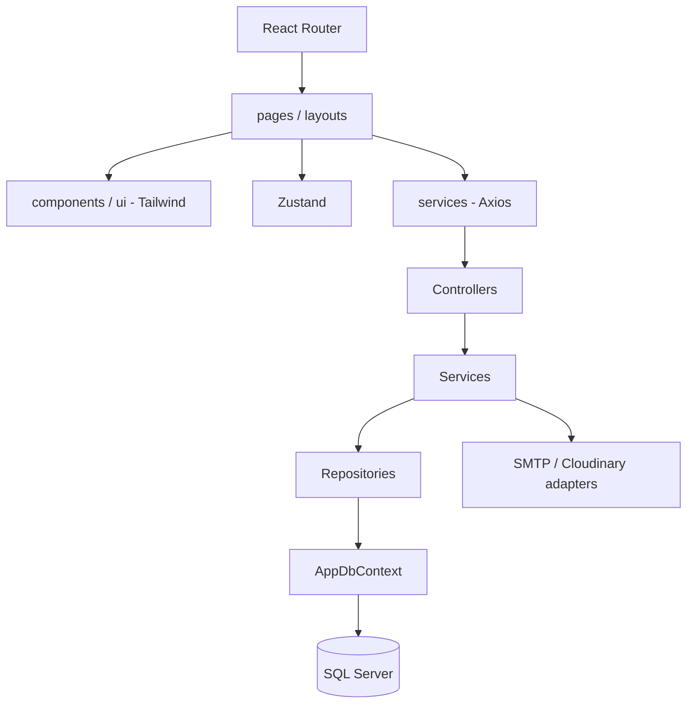

# Kiến trúc VNC HRMS

Một React SPA và một ASP.NET Core 8 Web API phân lớp, chia module trong cùng ứng dụng, dùng một database VNC_HRMS_Iteration1.

## Backend

- Controllers: route/HTTP và validation; tên ...Controller.cs, kế thừa ControllerBase.
- Services/Interfaces: hợp đồng I...Service; implementation ...Service.cs xử lý nghiệp vụ và transaction.
- Repositories/Interfaces: hợp đồng I...Repository; implementation truy vấn EF Core, không truy vấn SQL trong controller.
- Models: entity danh từ số ít PascalCase; DTOs: ...Request/...Response/...Dto.
- Persistence: AppDbContext, factory, migrations và timestamp; Configurations: DI, JWT, Swagger, options và mapping EF.
- Common/Middlewares/Security: exception, helper, lỗi toàn cục và 6 role policies.
- Integrations: adapter SMTP gửi OTP và Cloudinary upload tệp, được gọi từ service.

JWT xác minh chữ ký, issuer, audience và hạn dùng. Middleware kiểm tra phiên trong SQL, trạng thái tài khoản và phiên bản phân quyền; chức năng xác thực cấp/refresh/thu hồi token. Các module dùng chung 6 role policies.

## Frontend

pages, components/ui, layouts, services (Axios), store (Zustand), routes, hooks/types/utils/styles. Mỗi màn kết thúc bằng Page.tsx, HTTP module ...Api.ts, store use...Store.ts. React Router đăng ký các màn xác thực, tài khoản và nhân sự; ProtectedRoute kiểm tra đăng nhập và quyền truy cập.

## Database

Một context quản lý 37 bảng ứng dụng trong schema `dbo`: 36 bảng theo thiết kế 2.0 và bảng OTP bổ sung. Mật khẩu nằm trong `users`; `staff.user_id` bắt buộc và duy nhất. Không dùng bảng `credentials` riêng. `InitialApplication` giữ nguyên lịch sử; `AlignSchemaVersion2` chuyển schema, gộp dữ liệu xác thực và bổ sung khóa ngoại mà giữ ID, mật khẩu và quyền. Chi tiết các cột kỹ thuật bổ sung, quy trình cấp tài khoản và cập nhật database xem [MIGRATION.md](MIGRATION.md). Các bảng không đồng nghĩa mọi nghiệp vụ đã hoàn thành.

## Quy trình nhóm

1. Thống nhất DTO/route/policy với thành viên liên quan.
2. Thêm repository, service và controller cho module; đăng ký DI.
3. Khi đổi entity/mapping, tạo migration mới; không sửa migration đã dùng chung.
4. Thêm API client, page, route/menu frontend đúng quyền.
5. Build và kiểm tra chức năng trước khi commit.

Không thêm project API/port/database riêng cho từng nghiệp vụ. Không commit secret, .local, node_modules, bin, obj hoặc dist.
